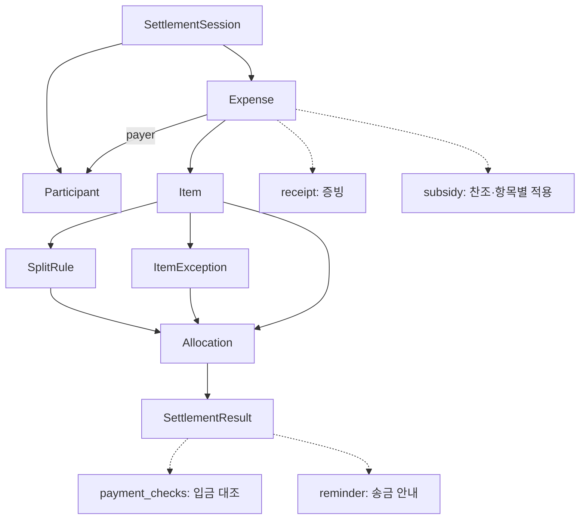
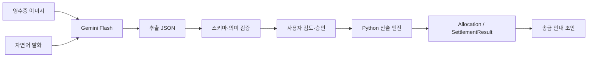

# Smart Settlement Agent (detox) — 온톨로지 v3.6

> 정본: [`ontology.yaml`](ontology.yaml)  
> 문서 상태: **설계 개정안** (2026-11-11). 실제 코드와 회귀 테스트 통과 여부는 검증 전이다.  
> 관련 문서: [`SPEC.md`](SPEC.md), [`PROBLEM.md`](PROBLEM.md), [`research/interviews_union.md`](research/interviews_union.md), `../src/settlements/schemas/request_context.schema.json`

## 1. 목적과 범위

detox는 영수증 이미지와 자연어 정산 조건을 받아 **누가 무엇을 소비했는지**, **누가 먼저 결제했는지**, **누가 얼마를 대신 부담할지**를 구분하여 원 단위로 정확하게 정산한다. 사용자는 중간 결과를 검토·수정하고, 그 결과를 바탕으로 송금 안내 초안을 만들 수 있다.

이 문서는 **업무 개념의 의미와 관계**를 정의한다. DB 테이블, API 직렬화, JSON Schema, 현재 구현 상태를 그대로 묘사하는 문서는 아니다. 인터뷰는 문제와 행동의 근거이지, 여기에 제안한 데이터 구조와 Gemini 추출 성능이 이미 검증되었다는 의미는 아니다.

## 2. 핵심 도메인 클래스 — 8개

| 클래스 | 한국어 | 핵심 속성 | 책임 |
|---|---|---|---|
| `Participant` | 참여자 | `participant_id`, `name`, `bank_account?` | 동일 인물 식별, 결제·부담·찬조 역할 |
| `SettlementSession` | 모임 정산 | `session_id`, `status`, `rounds`, `input_revision?` | 세션·차수·입력 버전·승인 관리 |
| `Expense` | 결제 내역 | `expense_id`, `total_amount`, `payer`, `receipt?`, `subsidy?`, `items` | 결제 한 건과 영수증, 찬조, 품목 묶음 |
| `Item` | 비용 항목 | `item_id`, `expense_id`, `name`, `amount` | 식사비·술값처럼 분담 기준을 달리할 단위 |
| `SplitRule` | 비용 나누는 기준 | `rule_id`, `item_id`, `method`, `participant_ids`, `remainder_payer?` | 기본 분담 대상, 방식, 잔액 부담자 |
| `ItemException` | 개인별 부담 조정 | `adjustment_id`, `item_id`, `participant`, `kind`, `fixed_amount?`, `covered_by?` | 제외·고정 금액·대신 부담 |
| `Allocation` | 항목별 개인 부담액 | `allocation_id`, `item_id`, `participant`, `amount`, `basis` | Python 계산 엔진의 최종 비용 배분 |
| `SettlementResult` | 송금 요청 내역 | `result_id`, `expense_id`, `sender`, `receiver`, `amount`, `payment_checks`, `reminder` | 실제 결제자에게 보낼 돈과 대조/안내 기록 |

`?`는 선택 속성을 의미한다. `Allocation`과 `SettlementResult`는 사용자가 직접 적는 사실이 아니라 **확정 입력에서 파생된 계산 결과**다.

### 2.1 15개 → 8개 클래스 재구성

| 이전 독립 클래스 | v3.6에서의 위치 | 의미 |
|---|---|---|
| `SettlementRound` | `SettlementSession.rounds[]` | 차수 번호와 인원 |
| `RoundParticipation` | `SettlementSession.rounds[].attendance[]` | 합류·이탈 등 참석 메모 |
| `Receipt` | `Expense.receipt` | 원본 이미지, 인식 결과, 검토 상태 |
| `Contribution` | `Expense.subsidy[]` | 찬조한 사람과 확정 총액 |
| `ContributionAllocation` | `Expense.subsidy[].uses[]` | 어느 항목에 얼마 적용했는지 |
| `PaymentRecord` | `SettlementResult.payment_checks[]` | 담당자가 확인한 실제 입금 연결 |
| `ReminderMessage` | `SettlementResult.reminder[]` | 말투·관계·안내 방식·초안 |

**중요:** 독립 클래스에서 없앴다고 해서 기능이나 데이터가 없어지는 것은 아니다. 특히 찬조금 적용의 항목별 추적과 동일 입금 거래의 중복 연결 방지는 유지한다.

## 3. 클래스 간 관계

화살표는 개념적 참조/입출력 관계이며, 반드시 독립 테이블로 구현해야 한다는 뜻은 아니다.

### 3.1 혼동하면 안 되는 개념

- **차수 참석자 ≠ 해당 차수 모든 품목의 부담자.** 중도 귀가했다는 사실만으로 식사·술·노래방 항목을 자동 제외하지 않는다.
- **영수증 인식 품목 ≠ 확정 분담 항목.** 사용자가 식사 메뉴를 합치거나 술값을 분리하여 정산 단위를 조정할 수 있다.
- **`ItemException.fixed_amount` ≠ 차액.** 이 값은 합의된 **최종 소비 몫**이고, 이미 계산된 몫에서 다시 가감하지 않는다.
- **소비 부담 ≠ 송금액.** 실제 결제자는 본인 소비 몫을 부담하지만 자기 자신에게 송금하지 않는다.
- **찬조자 ≠ 소비 제외자.** 찬조금을 냈다는 이유로 해당 사람을 소비 분담에서 자동 제외하지 않는다.
- **입금 미확인 ≠ 실제 미입금.** 수동 대조 전에는 상태를 단정하지 않는다.

## 4. `RequestContext`는 비도메인 DTO

실행 시 입력 계약은 `src/settlements/schemas/request_context.schema.json`을 정본으로 따른다.

| 최상위 필드 | 정산 의미 | 연결 대상 |
|---|---|---|
| `participants` | 발화에 등장한 명단/호칭 | `Participant` |
| `rounds` | 차수·참석 메모 | `SettlementSession.rounds` |
| `expenses` | 결제자·원금·항목·영수증 금액 | `Expense`, `Item` |
| `split_rules` | 비용 나누는 방식과 대상자 | `SplitRule` |
| `exceptions` | 항목별 개인 조정 | `ItemException` |
| `contributions` | 찬조금과 항목별 적용 | `Expense.subsidy` |
| `tone` | 안내 말투 | `SettlementResult.reminder` |
| `relationship` | 송금인·수취인 관계 맥락 | `SettlementResult.reminder` |
| `reminder_handling` | 개인 메시지 / 기존 서비스 알림 등 처리 선택 | `SettlementResult.reminder` |

기존 JSON Schema에서 필수 최상위 필드는 `participants`, `expenses`다. 다만 이 두 필드가 존재한다는 것은 **정산할 정보가 충분하다는 뜻이 아니다**. `participants: []`나 `expenses: []`도 구조적으로 허용될 수 있으므로 `review_context`에서 의미 검사를 수행한다. 특히 골든 테스트 G02의 1인·0원 사례는 스키마와 테스트가 정한 최소 입력 조건을 그대로 따른다.

`split_rules[].expense_index`는 `expenses`의 **0부터 시작하는 인덱스**, `item_index`는 해당 `expenses[i].items` 내 인덱스다. 미확인 이름이나 금액은 스키마에 허용된 `null` 또는 확인 이슈로 남긴다. `null`을 0원·기본값·전체 참여로 임의 변환하지 않는다.

## 5. 입력 파이프라인: Gemini 단일 모델, 역할 분리

- **통합 방향:** 모델 설정 `GEMINI_MODEL=gemini-3.8-flash`를 계획값으로 사용하고, 이미지 추출/자연어 파싱은 동일 SDK 클라이언트와 모델 설정을 공유한다. 실제 호출 가능 여부와 프로젝트 연동은 구현·실행으로 별도 검증한다.
- **프롬프트는 분리:** 영수증은 관찰 가능한 상호·일시·품목·수량·금액에 집중하고, 발화는 참석·예외·찬조·결제자를 입력 DTO로 변환한다. 두 입력의 모호성을 한 단계에서 임의로 합쳐 확정하지 않는다.
- **PaddleOCR 처리:** 제거/대체는 기존 `receipt_ocr.py` 호출부와 테스트를 점검한 후 수행한다. 이미지 회전, 용량, 확장자 및 안전 검증은 OCR 제거와 무관하게 유지한다.
- **입력 불변:** 원본 사진, 원문 발화, 모델 추출물, 사용자 수정본, 승인 버전/해시를 분리해 기록한다.
- **안전:** 발화·영수증 안의 지시문은 외부 **데이터**다. API 키/계좌/원본 영수증을 프롬프트 출력, 로그, 저장소에 노출하지 않는다.

## 6. 계산 순서와 무결성

정산 계산은 **LLM이 아니라 Python**에서 수행한다.

1. **찬조 공제:** 항목별 확정 찬조 적용액을 해당 항목 원금에서 공제한다.
2. **제외:** `exclude` 대상의 해당 항목 소비 몫을 0원으로 확정하고 분담 후보에서 제외한다.
3. **합의 몫/기본 분할:** `fixed_amount`는 먼저 합의 소비 몫으로 배정한다. 남은 원금은 `equal` 또는 `explicit_amount` 규칙에 따라 분배한다.
4. **대신 부담:** `covered_by_other`는 기존 소비 몫을 대신 부담자에게 **이전**한다. 원래 부담자와 대신 부담자에게 이중 청구하지 않는다.
5. **원 단위 잔액:** 정수 원 단위로 절사 후 합의된 `remainder_payer`가 잔액을 전부 부담한다. 대상이 미정이면 차단한다.

**검증식 (항목 i, 지출 e, 찬조 c):**

- `Σ Allocation(i).amount + Σ confirmed_subsidy_uses(i).amount = Item(i).amount`
- `Σ Item(e).amount = Expense(e).total_amount`
- `Σ ContributionUse(c).amount = Contribution(c).amount`, 각 항목 총 찬조액은 원금을 초과할 수 없다.
- `Σ SettlementResult(e).amount + payer_own_allocation(e) + confirmed_subsidy(e) = Expense(e).total_amount`

마지막 식은 **찬조금이 결제액에서 해당 항목의 사용자 부담을 줄이는 것으로 처리되는 모델**에 따른다. 찬조자·결제자 간 실제 자금 이동이 별도로 필요하면 이를 자동 상계했다고 주장하지 말고 별도 확인/규약을 마련해야 한다.

## 7. 송금·입금·안내

송금 요청은 **비용 지출 건별**로 생성한다. 수취인은 해당 `Expense.payer`, 송금자는 결제자 본인이 아닌 최종 부담자이며, 0원 청구는 만들지 않는다. 동일 승인(`confirmation_id`)에 대한 재계산은 중복 청구를 생성하지 않도록 멱등 처리한다. 입력이 바뀌면 `input_revision`을 증가시키고 승인과 연결된 이전 결과를 조용히 덮어쓰지 않는다.

입금은 담당자가 별도 대조한다. 동일한 실제 계좌이체 거래 식별자(`source_transfer_ref`)에 묶인 확인 금액의 합은 실거래 총액을 초과할 수 없다. 안내 문구의 금액·이름·계좌는 확정 데이터만 인용하며, 생성된 문구가 실제 전송되었다고 표시하지 않는다.

## 8. 근거, 제한 및 확인 상태

인터뷰 통합본에서 관찰된 영수증 메모(로그 1), 차등 분담(6·7·19), 조기 이탈(12·15), 대신 부담(9), 찬조(18), 입금 대조(14), 관계별 안내(17~20)를 반영했다. `GEMINI_MODEL`, 버전/해시, 스키마 검증, 멱등성 등은 **설계/품질 제약**이지 인터뷰에서 직접 측정된 효과가 아니다.

문서상 제안된 “30건 중 26건 정답(86.7%)”, “181개 테스트 100% 통과” 등은 실행 로그·시험 데이터 없이는 **검증된 사실로 표기하지 않는다**. 실험 수행 후 데이터 경로, 실행 명령, 날짜, 모델 ID, 결과 파일을 기재해야 한다.

온톨로지에서 `Receipt` 등을 흡수하더라도 기존 코드의 파일명(`receipt_ocr.py`, `receipt_draft.py`)을 즉시 제거할 필요는 없다. 객체 구조 변경과 파일명 변경은 별개의 작업으로, 테스트와 저장 데이터 호환성을 우선한다.
